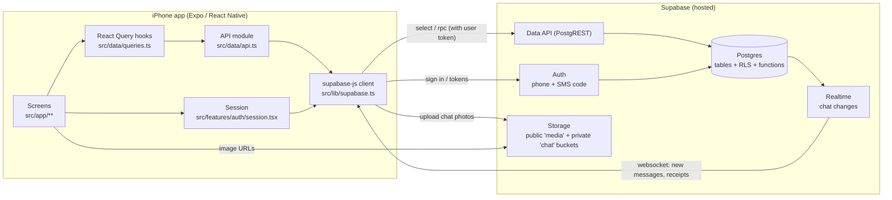
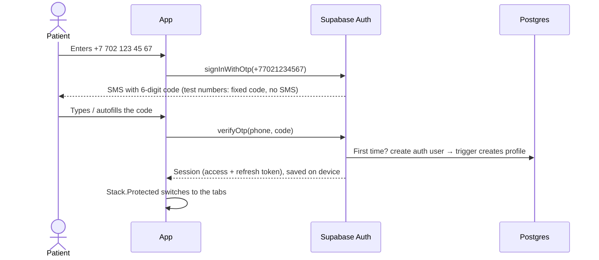
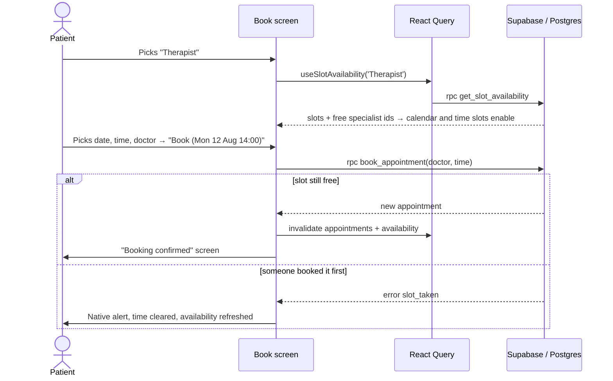
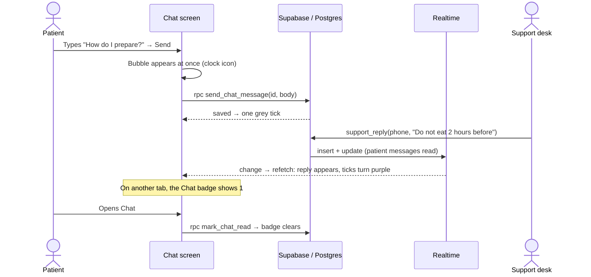

# Doctor Dent — how the app is built

Doctor Dent is an iPhone-first dental clinic app. Patients sign in with their phone number, browse specialists, book, reschedule and cancel visits, review past visits, and chat with the clinic's support desk.

This document explains the stack, how the code is organised, and how the app and the backend work together. For day-to-day coding rules, see [`AGENTS.md`](../AGENTS.md).

---

## 1. The big picture



There is **no custom server**. The app talks directly to Supabase with a public ("publishable") key and the signed-in user's token. Security comes from the database itself: row-level security decides which rows each patient can see, and database functions enforce the booking rules. So even a modified app can't book outside clinic hours or see someone else's appointments.

---

## 2. Stack

### Frontend (the iPhone app)

| Concern | Choice | Why |
|---|---|---|
| Framework | **Expo SDK 58** (React Native 0.88, React 19.3, TypeScript 6) | One codebase, cloud builds, no Xcode needed |
| Navigation | **Expo Router**: file-based routes in `src/app/` | Each file is a screen; folders define navigators |
| Tab bar | `NativeTabs` (`expo-router/native-tabs`) | The real iOS `UITabBar`, with Liquid Glass on iOS 26+ (always expanded — `minimizeBehavior="never"`) |
| Headers and back buttons | Native stack (`react-native-screens`) | Real iOS navigation bars and glass back buttons |
| Icons | SF Symbols via `expo-symbols`, plus SVGs exported from Figma | Native look; Figma assets where the design has custom art |
| Images | `expo-image` | Caching, SVG support, smooth loading |
| Chat keyboard | `react-native-keyboard-controller` | Composer and messages move with the keyboard frame by frame (in Expo Go) |
| Photo picking | `expo-image-picker` | System photo picker and camera for chat attachments |
| Server data | **TanStack React Query** | Caching, loading and error states, refetch, invalidation |
| Backend client | **`@supabase/supabase-js`** | Auth, database queries, function calls, storage, realtime |
| Session storage | `expo-sqlite/localStorage` | Keeps you signed in between launches (Expo's recommended setup) |
| Styling | `StyleSheet` + design tokens in `src/theme/index.ts` | Tokens mirror the Figma variables one to one |
| Builds | **EAS Build** (cloud) | iOS builds without a local Mac toolchain |

### Backend

| Concern | Choice |
|---|---|
| Platform | **Supabase** (hosted) |
| Database | Postgres: tables, row-level security (RLS) and PL/pgSQL functions |
| Auth | Supabase Auth, **phone number + 6-digit SMS code** |
| Files | Supabase Storage: public `media` bucket (doctor photos, promotion banners, agent avatars), private `chat` bucket (chat photos) |
| Live updates | Supabase Realtime (Postgres changes on `chat_messages`, filtered by RLS) |
| Schema management | Supabase CLI v3 (migrations in `supabase/migrations/`) |
| DB tests | PGlite (Postgres compiled to WebAssembly), so no Docker is needed |

---

## 3. Repository layout

```
dentist-app/
├── app.json                  Expo config (name, icons, plugins)
├── .env.example              Template for Supabase URL + publishable key (copy to .env.local)
├── AGENTS.md                 Coding conventions for this project
├── docs/ARCHITECTURE.md      This document
├── assets/images/            App icon, splash, Figma-exported SVGs (logo, icons, illustrations)
├── src/
│   ├── app/                  ROUTES — every file is a screen (Expo Router)
│   ├── components/           Reusable UI (cards, buttons, booking pieces, …)
│   │   └── ui/               Primitives: Text, Button, Card, Chip, Rating
│   ├── data/
│   │   ├── api.ts            The only file that talks to Supabase; maps rows → app types
│   │   ├── queries.ts        React Query hooks used by screens
│   │   └── constants.ts      Specialties, slot hours, booking window, price formatting
│   ├── features/auth/        Session provider (sign in, verify code, sign out)
│   ├── features/chat/        Photo source menu + picker for chat attachments
│   ├── lib/                  supabase client, date helpers, useNow
│   ├── navigation/           Shared native-stack options
│   └── theme/                Design tokens (colors, spacing, radius, typography, shadows)
└── supabase/
    ├── config.toml           Auth (phone, test numbers), storage bucket, local dev settings
    ├── migrations/           Database schema, RLS and functions (SQL)
    ├── seed.sql              Specialists, reviews, promotions
    ├── media/                Images uploaded to the `media` bucket
    └── tests/                Database tests (npm run test:db)
```

---

## 4. Frontend in detail

### 4.1 Navigation

```
src/app/
├── _layout.tsx               Root stack + providers; chooses (auth) or (tabs)
├── (auth)/                   Shown when signed out
│   ├── sign-in.tsx           Phone number
│   └── verify.tsx            6-digit SMS code
├── (tabs)/_layout.tsx        Native tab bar: Home · Sessions · Book · Chat · Profile
│   ├── (home)/               index.tsx (Home), specialists/index.tsx (all specialists)
│   ├── (sessions)/           sessions.tsx (My Appointments)
│   ├── (book)/               book.tsx (booking flow), booking-success.tsx
│   ├── (chat)/               chat.tsx (Support Chat)
│   └── (profile)/            profile.tsx, history.tsx
├── specialist/[id].tsx       Specialist page, pushed above the tab bar
├── promotion/[id].tsx        Promotion page (full-screen modal, glass ✕, "Book a Session")
└── photo.tsx                 Chat photo viewer (native modal sheet, pinch to zoom)
```

- **Signed in or not:** `Stack.Protected` in `_layout.tsx` shows `(auth)` or `(tabs)` based on the session. There are no manual redirects.
- **Tabs:** each tab has its own native stack, so pushing a screen keeps the tab bar and gets a native glass back button.
- **Titles:** the native header can't render SF Pro Rounded, so page titles are drawn in the page with `<PageTitle>` and the header carries only the glass buttons.
- **Pinned buttons** ("Book (…)", "Go to My Appointments") use `<PinnedFooter>`. It sits just above the floating iOS tab bar.

### 4.2 Design system

`src/theme/index.ts` holds the Figma variables (`--color-*`, `--space-*`, `--radius-*`, text styles, `shadow/*`). Screens never hardcode colors or spacing. Components follow the Figma component names, e.g. `Button` (Primary / Secondary / Danger outline), `BookingSummaryCard` ("Booking summary") and `SpecialistPickCard` ("card / specialist").

### 4.3 Data layer: three layers, one direction

```
Screen  →  queries.ts (React Query hook)  →  api.ts (Supabase call + mapping)  →  Supabase
```

- **`api.ts`** knows table and column names, calls Supabase and converts rows into app types (`Specialist`, `Appointment`, …). It also turns database error codes such as `slot_taken` into friendly messages.
- **`queries.ts`** wraps each call in React Query. Reads are cached, so switching tabs doesn't refetch everything. Writes invalidate what they affect: booking refreshes My Appointments and availability.
- **Screens** only use hooks such as `useSpecialists()`, `useAppointments()` and `useBookAppointment()`. They show `<LoadingView>` and `<ErrorView>` (with Try again) and support pull-to-refresh.

### 4.4 Support chat

- **Screen** (`(chat)/chat.tsx`): an inverted `FlatList` (newest at the bottom) on a `KeyboardChatScrollView`, with the composer in a `KeyboardStickyView`. The composer sits above the floating tab bar; when the keyboard opens, both rise by the keyboard height minus that tab-bar space. Messages are grouped by day ("Today", otherwise "12 August"), with the agent's name on the first message of a run and the avatar on the last.
- **Status ticks** on the patient's messages: clock = sending, one grey tick = sent, two grey = delivered, two purple = read, red badge = failed (tap to retry or delete).
- **Optimistic sending:** each message gets its id on the device (`expo-crypto`). While a send is in flight, `useChatThread()` shows it from the mutation's variables, then swaps in the server row with the same id. Retrying reuses the id, so a message is never stored twice.
- **Photos:** `+` opens a native action sheet (library or camera). Photos upload to `chat/<patient id>/<uuid>.jpg` first, then the message is sent with their paths. The bucket is private; `api.ts` signs the URLs (valid for a day) when it loads the conversation.
- **Live updates:** `useChatRealtime()` runs in the tabs layout. Any change to the patient's messages (a reply, a delivered or read receipt) invalidates the chat queries, and so does returning to the foreground. The Chat tab badge is `useUnreadChatCount()`; opening the chat calls `mark_chat_read`.

### 4.5 Session

`src/features/auth/session.tsx` wraps Supabase Auth:

- On launch it restores the saved session (the splash screen stays up until this is done, so signed-in users never see the sign-in screen flash).
- `requestCode(phone)` → `supabase.auth.signInWithOtp({ phone: '+7…' })`
- `verifyCode(code)` → `supabase.auth.verifyOtp({ phone, token, type: 'sms' })`
- Tokens refresh automatically while the app is in the foreground.
- Signing out clears the React Query cache, so one patient's data never shows for the next.

---

## 5. Backend in detail

### 5.1 Tables

```mermaid
erDiagram
  AUTH_USERS ||--|| PROFILES : "1:1 (trigger)"
  PROFILES ||--o{ APPOINTMENTS : books
  SPECIALISTS ||--o{ APPOINTMENTS : "is booked for"
  SPECIALISTS ||--o{ REVIEWS : receives
  APPOINTMENTS |o--o| REVIEWS : "reviewed once"
  PROFILES |o--o{ REVIEWS : writes
  PROFILES ||--o{ CHAT_MESSAGES : "has one conversation"
  SUPPORT_AGENTS |o--o{ CHAT_MESSAGES : "replies in"

  PROFILES { uuid id; text phone; text full_name; text home_address }
  SPECIALISTS { uuid id; text full_name; specialty specialty; text photo_path; int years_of_experience; int price_from; numeric rating; int review_count }
  APPOINTMENTS { uuid id; uuid patient_id; uuid specialist_id; timestamptz starts_at; appointment_type type; appointment_status status }
  REVIEWS { uuid id; uuid specialist_id; uuid appointment_id; text author_name; numeric rating; text body }
  PROMOTIONS { uuid id; text title; text image_path; int sort_order; text headline; text body; text hero_image_path; text cta_label }
  CHAT_MESSAGES { uuid id; uuid patient_id; chat_sender sender; uuid agent_id; text body; text_array image_paths; timestamptz delivered_at; timestamptz read_at }
  SUPPORT_AGENTS { uuid id; text name; text avatar_path }
```

- A **profile** is created automatically when someone signs up for the first time (a trigger on `auth.users`).
- An appointment's **status** is `scheduled` or `cancelled`. "Completed" isn't stored: a scheduled appointment in the past *is* a completed visit, so the app splits upcoming and history by time.
- `rating` and `review_count` on specialists are stored on the row (updated when a review is added), so lists don't need to count reviews.
- **Promotions** with a `body` open a full-screen page (headline, text, large `hero_image_path` photo, `cta_label` button that opens the Book tab); promotions without one are plain tiles. Edit them in the dashboard.
- **Chat:** each patient has one conversation with the clinic: every `chat_messages` row with their `patient_id`. A message's status is derived from `delivered_at` / `read_at` (neither set = sent). New patients get a welcome message from support (a trigger on `profiles`).

### 5.2 Who can do what (row-level security)

| Data | Read | Write |
|---|---|---|
| Specialists, reviews, promotions | Everyone | Nobody from the app (seeded or edited in the dashboard) |
| Profiles | Only your own | Only your own name and address (`phone` is locked) |
| Appointments | Only your own | Only through the functions below, never directly |
| Chat messages | Only your own conversation | Only through `send_chat_message` / `mark_chat_read`; support replies only from the clinic side |
| Chat photos (`chat` bucket) | Only your own folder | Upload into your own folder only |
| Support agents | Signed-in patients | Nobody from the app |

### 5.3 Business rules: database functions

All booking rules run inside Postgres, in clinic time (**Asia/Almaty**):

| Function | What it does |
|---|---|
| `get_slot_availability(specialty)` | Every bookable slot in the next 14 days with the specialists still free in it. It only reveals specialist ids, never other patients. |
| `book_appointment(specialist, starts_at, reschedule_id?)` | Books a slot, or moves an existing appointment. Checks: weekday, 09:00–19:00 start, on the hour, today plus 13 days, in the future. The doctor must be free (a unique index prevents double-booking), and you can't hold two visits at once. Sets "First" or "Follow-up appointment" automatically. |
| `cancel_appointment(id)` | Cancels your own future appointment. |
| `leave_review(appointment, rating, text)` | One review per completed visit. Updates the specialist's rating. |
| `delete_my_account()` | Deletes your user. Profile, appointments and chat go with it; reviews stay but become anonymous. The app deletes your chat photos from storage first. |
| `send_chat_message(id, body, image_paths)` | Sends a text and/or photos (up to 10, only from your own folder). Safe to retry with the same id. |
| `mark_chat_read()` | Marks support messages read, which clears the badge. |

**Support desk** (only from the Supabase SQL editor or with the service role; the app can't call these):

| Function | What it does |
|---|---|
| `support_reply(phone, body, agent = 'Jessica', image_paths = '{}')` | Replies as an agent. Also marks the patient's messages read. |
| `support_mark_delivered(phone)` | The desk has seen the conversation: the patient's messages show "Delivered". |

For example, in Dashboard → SQL Editor: `select support_reply('77021234567', 'Just do not eat 2 hours before the appointment');`. To reply with a photo, upload it in Storage → `chat` → the patient's folder (their user id), then pass its path in `image_paths`.

Each function raises a short error code (`slot_taken`, `slot_unavailable`, `patient_busy`, …), which `api.ts` turns into the message the patient sees.

### 5.4 Storage

Doctor photos, promotion banners and support agent avatars live in the public **`media`** bucket. The database stores only the file name (`photo_path`, `image_path`, `avatar_path`); `mediaUrl()` in `src/lib/supabase.ts` builds the public URL.

Chat photos live in the private **`chat`** bucket (10 MB limit, images only), one folder per patient. Storage policies limit each patient to their own folder, and the app shows photos through signed URLs.

---

## 6. How it all works together

### Signing in



### Booking a visit



**Rescheduling** works the same way: Edit on My Appointments opens the Book tab with the doctor preselected and sends `reschedule_id`. **Cancelling** calls `cancel_appointment`, and the list refreshes.

### Chatting with support



---

## 7. Setup and everyday commands

> Expo SDK 58 needs **Node ≥ 22.13**. Run `nvm use` in the project folder (`.nvmrc` pins Node 26).

### One-time: connect a Supabase project

1. Create a project at [supabase.com/dashboard](https://supabase.com/dashboard). Note the **project ref** (in the URL) and the **database password**.
2. Log the CLI in and link the project:
   ```bash
   npx supabase login
   npx supabase link --project-ref <your-project-ref>
   ```
3. Push everything:
   ```bash
   npm run db:push     # schema + seed data
   npm run db:config   # phone auth, test numbers, storage settings (from supabase/config.toml)
   npm run db:media    # uploads supabase/media → the public 'media' bucket (incl. support avatar)
   ```
4. Copy `.env.example` to `.env.local` and fill in the **Project URL** and **publishable key** (Dashboard → Project Settings → API Keys). Never put the database password or a secret key in the app.
5. `npx expo start` and sign in with a test number.

### Test numbers (development)

Defined in `supabase/config.toml` under `[auth.sms.test_otp]`. No SMS is sent.

| Phone (enter in the app) | Code |
|---|---|
| 702 123 45 67 | `123456` |
| 701 111 22 33 | `111111` |

### Commands

| Command | What it does |
|---|---|
| `npx expo start` | Run the app (Expo Go or a development build) |
| `npm run lint` / `npx tsc --noEmit` | Lint and typecheck |
| `npm run test:db` | Runs all migrations + seed in PGlite and tests booking, chat rules and RLS (59 checks) |
| `npx supabase migration new <name>` | Create a new migration file for a schema change |
| `npm run db:push` | Apply new migrations to the hosted project |
| `npx eas-cli@latest build -p ios` | Cloud iOS build (EAS) |

### Changing the backend safely

1. Add a new migration (`npx supabase migration new …`). Never edit one that has already been pushed.
2. Run `npm run test:db` and add a check for the new rule.
3. `npm run db:push`.
4. Update `src/data/api.ts` (types and mapping) and, if needed, `queries.ts`.

---

## 8. Known gaps and next steps

- **Support desk app:** clinic staff reply from the Supabase SQL editor (`support_reply`). A small staff web app (or a Slack / Telegram bridge calling the same functions with the service role) is the next step.
- **Chat push notifications:** replies update live while the app is open; with the app closed, nothing alerts the patient yet. Next: `expo-notifications` + a database webhook that sends an Expo push.
- **Chat history** loads the latest 200 messages; older ones need pagination when conversations get long.
- **Real SMS:** replace the placeholder Twilio settings in `config.toml` (token via env var) and remove `[auth.sms.test_otp]` before launch.
- **Code length:** Supabase SMS codes are always 6 digits, so the code screen shows 6 boxes instead of Figma's 4.
- **Time zone:** clinic hours are in Asia/Almaty. The app shows slots in the phone's time zone, which is correct for patients in Kazakhstan.
- **Profile editing** uses native prompts for now; Figma has no profile form yet.
- **Typed database client:** `npx supabase gen types typescript --remote` can replace the hand-written row types in `api.ts`.
- **Admin side:** specialists and promotions are managed in the Supabase dashboard; there is no staff app.
